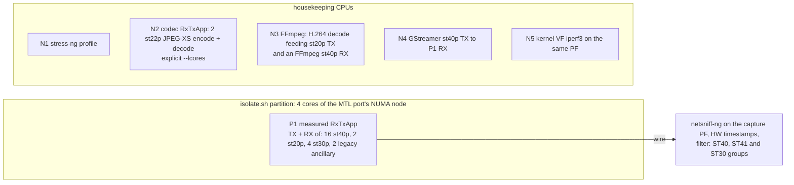
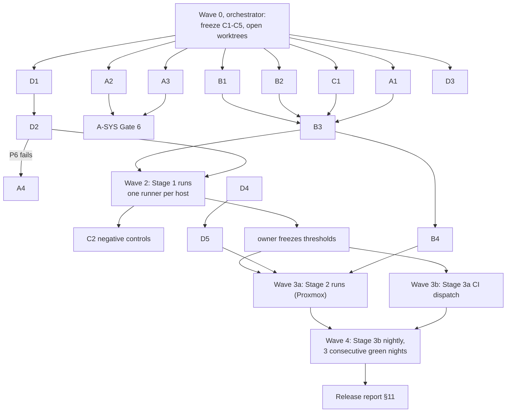
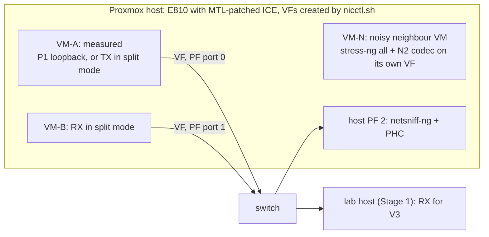

# ST40 release test plan: mixed essences, noisy neighbours, user pacing, dynamic isolation

Branch under test: `st40-tx-cleanup-plugins` (6 commits on `main`, about 7.2k lines added).

| Commit | What the plan has to prove under load |
|---|---|
| `8cbcf764` ST 2110-41 fast metadata on st40p | Many ST41 st40p sessions deliver every data item, in order, with the right DIT/K bit, next to video and audio |
| `c35fc66a` ST40 RX FMD 2022-7 filter on seq alone | Redundant ST41 survives a leg loss and a TX restart with a lower seq without false loss or a stall |
| `8a86408f` st40p RX in order, busy-frame drops counted | No reordering and `stat_frames_dropped` stays 0 when the consumer keeps up |
| `8cd7a6fb` ST40 TX timing after an abort and with USER_TIMESTAMP | On the wire, USER_PACING frames are never early and USER_TIMESTAMP values reach the RTP header exactly |
| `44f0c05e` fail-closed FMD verdicts | The verdicts this plan relies on cannot pass a run that lost or reordered items |
| `6a725ba1` FFmpeg / GStreamer st40p | The plugins work as a second MTL process next to the measured one |

The TX session itself was rewritten (`lib/src/st2110/st_tx_ancillary_session.c`; design and test map in `doc/st40_tx_session.md`).

**Release question.** Many st40p sessions use user-controlled pacing and user-injected timestamps. They run next to st20p and st30p sessions, with JPEG-XS / H.264 encode and decode as noisy neighbours and dynamic CPU isolation on. Do they stay correct on the wire, and on time as captured by netsniff-ng with hardware timestamps? Is that true locally, in Proxmox VMs on another host, and in CI?

The plan is laid out for concurrent subagents.

- §5 fixes the contracts every work package codes against.
- §6 gives each work package a disjoint set of files it owns.
- §7 orders the waves so that code work runs in parallel and hardware runs never overlap on one host.

---

## 1. What exists and what is missing

Facts below were checked on this branch; file references are clickable.

### 1.1 Reusable pieces

- **RxTxApp can mix every session type in one JSON.** st20p, st22p, st30p, st40p, ancillary, video and audio all work together (`tests/tools/RxTxApp/src/parse_json.c:2409-2449`). The limit is 180 st40p sessions (`app_base.h:36-43`).
- **The pytest engine builds multi-type commands.** `RxTxApp.create_command(sessions=[...])` does it (`tests/acceptance/mtl_engine/rxtxapp.py:579-648`).
- **st40p sessions already parse the timing keys.** `fast_metadata`, `fastmetadata_data_item_type`, `fastmetadata_k_bit`, `fps`, `interlaced`, `user_pacing`, `exact_user_pacing`, `drop_when_late` and 2022-7 via 2-entry `dip`/`interface` all parse (`parse_json.c:1083-1186`).
- **All TX sessions share one user clock.** st20p, st30p and st40p take `ctx->user_time`: base TAI + frame_num × frame_time + `user_time_offset` (`rxtx_app.c:645`). That makes cross-essence alignment checkable on the wire.
- **Dynamic isolation already exists.** `tests/tools/isolate/isolate.sh` creates an exclusive cgroup-v2 cpuset partition that lives as long as one command. It runs at nice −20 with IRQs, vmstat and NUMA balancing moved off the partition.
  - pytest uses it through `cpu_isolation="require"` (`universal_params.py:92`, `rxtxapp.py:690-719`).
  - NoCtx gtest uses it through `MTL_ISOLATE=require` (`.github/scripts/gtest.sh:379`).
- **Isolation evidence tools exist but nothing calls them.** `script/isolation_report.sh` / `script/isolation_monitor.sh` count bpftrace `sched_switch` intruders on given CPUs.
- **netsniff-ng capture.** `tests/acceptance/create_pcap_file/netsniff.py:228-250` captures with ns timestamps (`-T 0xa1b23c4d`), a BPF dst-IP filter and a PHC disciplined by phc2sys. The `pcap_capture` fixture is at `conftest.py:1185-1311`.
- **ST40 integrity verdicts.** `tests/acceptance/mtl_engine/integrity.py` (`st40p_pass`, `.info` seq_discont/seq_lost/marker/DIT/K checks).
- **Existing gtest coverage.**
  - `TxUserTimestampSync.st20_st30_st40_stay_in_sync` (`tests/integration_tests/tx_timestamp_sync_test.cpp:345`): session API, TX only, ≥90 % of beats aligned.
  - NoCtx `st40p_user_pacing*` (`tests/integration_tests/noctx/testcases/st40p_user_pacing_tests.cpp`): RX time within [0, +1 ms] of the requested TX.

### 1.2 Gaps; each one either blocks the scenario or would make it pass falsely

| ID | Gap | Effect if ignored | Fixed by |
|---|---|---|---|
| G1 | RxTxApp parses st40p `user_timestamp` (`parse_json.c:1177`) but `tx_st40p_app.c:288-296` never sets `ST40P_TX_FLAG_USER_TIMESTAMP` | Every "user-injected timestamp" st40p run tests nothing and still passes | WP-A1 |
| G2 | `include/st40_pipeline_api.h:113` still says USER_TIMESTAMP "uses MEDIA_CLK"; the session doc and `8cd7a6fb` say otherwise | Wrong API contract in the release | WP-A1 |
| G3 | pytest emits no `user_pacing` / `exact_user_pacing` / `user_timestamp` / `drop_when_late` for st40p, and no `user_pacing` for st30p (`rxtxapp.py:1076-1111`) | The scenario cannot be expressed in pytest | WP-B1 |
| G4 | `check_rx_output` reads only `rx_sessions[0][type][0]["replicas"]` (`rxtxapp.py:326,339`) | Several st40p entries with different flags are under-counted, so a lost session can pass | WP-B1 |
| G5 | Nothing in the repo checks ST40 / ST41 from a pcap (no scapy/dpkt/pyshark). EBU LIST is video-centric, and an ST41 stream shows as `unknown`, which fails its verdict (`compliance_client.py:237-280`) | No wire evidence at all for ST40 / ST41 timing or format | WP-C1 |
| G6 | No noise generator anywhere (no stress-ng / iperf / competing process in tests, scripts or CI); `stress-ng` is not in the CI apt list (`.github/scripts/setup_environment.sh:117` has netsniff-ng only) | "Noisy neighbour" cannot be run or reproduced | WP-B2, WP-D3 |
| G7 | No gtest runs st20p + st30p + st40p **pipelines** together; concurrent ST40 coverage is 2–3 streaming sessions | The cheapest tier, which runs on every PR, does not cover the release scenario | WP-A2 |
| G8 | `isolate.sh` holds `/run/mtl-isolate.lock` for the command's life and takes a fixed 4 physical cores per port node (`CORES=4`); unpinned threads all run on the partition's first CPU | One isolated process per host. Codec plugin threads cannot live in the partition. The measured process must fit in 3 clean schedulers | Scenario design (§2) + conditional WP-A4 |
| G9 | Dual-host pytest uses the legacy `mtl_engine/RxTxApp.py`, which has no fast metadata | Cross-VM ST41 cannot reuse `tests/dual/` | WP-B4 (Stage 2 only) |
| G10 | CI uploads no pcaps, has no VMs, no noise and no dual-host functional job; `custom-pytest.yml` cannot run dual tests | Stage 3 has nowhere to publish its evidence | WP-D3 |
| G11 | st30p has `USER_PACING` but **no** `USER_TIMESTAMP` (`include/st30_pipeline_api.h:43`) | Audio joins the scenario with user pacing only. Its timestamp coverage stays at the session level (`TxUserTimestampSync`) | Scope note, no WP |

Known defects deliberately kept by the TX rewrite are in `doc/st40_tx_session.md` §"Known defects kept on purpose". Defect 3 makes no-chain RTP-level RFC 8331 put different bytes on the wire. Any variant that combines `--tx_no_chain` with an RTP-level RFC 8331 session must list it as expected-fail, not hide it. The owner decides whether defects 1–9 block the release (§13).

---

## 2. The release scenario (S-REL)

### 2.1 Process layout per host



**Why this split.**

- **One isolated process.** `isolate.sh` allows one at a time per host (G8), so P1 carries TX and RX in one JSON, the way single-host pytest already does.
- **Video is the neighbour that matters most.** ST40 asks for scheduler quota 0 and joins the first scheduler on the socket (`st_tx_ancillary_session.c:2063`, `mt_sch.c:431,1133`), so it shares the lcore and the tasklet loop with st20p. ST40 pacing is always a software TSC gate; `--pacing_way` does not apply to it.
- **The codecs run outside the partition.** All unpinned plugin threads would share the partition's first CPU, and outside it they compete for LLC and memory bandwidth like a real neighbour.
- **N2 to N4 pin themselves.** Every MTL neighbour process passes explicit `--lcores` from the housekeeping set, so MtlManager never hands it a partition CPU.

### 2.2 Session table of P1

| Group | Count | Format | Timing flags | Purpose |
|---|---|---|---|---|
| A1 | 4 | st40p RFC 8331 p59.94 | default | baseline pacing next to video |
| A2 | 2 | st40p RFC 8331 i50 (interlaced) | USER_PACING | field handling under user pacing |
| A3 | 2 | st40p RFC 8331 p50 | EXACT_USER_PACING | exact path |
| F1 | 4 | st40p ST41 p59.94, DIT/K spread over the allowed range | USER_PACING + USER_TIMESTAMP | `8cd7a6fb` and `8cbcf764` together |
| F2 | 2 | st40p ST41 p50 | USER_TIMESTAMP only | timestamp without pacing (`8cd7a6fb`, G1) |
| F3 | 2 | st40p ST41 p25 | default + DROP_WHEN_LATE | late handling stays silent when nothing is late |
| R1 | 2 | st40p ST41 p59.94, ST 2022-7 (2 legs) | USER_PACING | `c35fc66a` |
| L1 | 2 | legacy `ancillary` (session API, `tx_ancillary_app.c`) | default | the session API path that RxTxApp uses |
| V1 | 2 | st20p 1080p59.94 YUV422 10-bit | USER_PACING + USER_TIMESTAMP | in-process video neighbour sharing the user clock |
| U1 | 4 | st30p PCM24 48 kHz 2 ch 1 ms | 2 × USER_PACING, 2 × default | audio neighbour (no USER_TIMESTAMP, G11) |

- **One user clock.** All user-timed sessions share `user_time` with a **non-zero, off-grid `user_time_offset`**, for example +2.123 ms.
  - Without the offset, user timestamps sit on the epoch grid and cannot be told apart from default pacing, so the USER_TIMESTAMP check (W4) would pass even with G1 unfixed.
  - The offset is what makes W4 and negative control NC3 discriminating.
- **Durations.** Functional runs 120 s, timing runs 300 s, soak §8.4.
- **Capacity check.** The P1 video load must fit in at most 3 schedulers in the partition: 2 TX + 2 RX 1080p59.94 plus quota-0 ST40 and audio. The 4th scheduler would share the EAL main CPU's sibling (`tests/tools/isolate/README.md` §Limits). Preflight P6 verifies this from the MTL log. If it does not fit, WP-A4 adds a core-count knob to `isolate.sh`.

### 2.3 Address plan (contract C4)

`SID` = the host's `session_id` (77 on the lab host; see §8.1).

| Class | P leg | R leg | UDP port | Captured |
|---|---|---|---|---|
| st40p (A, F, R groups) | `239.SID.40.N` | `239.SID.41.N` | 40000 + 2N | always |
| legacy ancillary (L1) | `239.SID.43.N` | — | 43000 + 2N | always |
| st30p (U1) | `239.SID.30.N` | — | 30000 + 2N | always |
| st20p (V1) | `239.SID.20.N` | — | 20000 + 2N | only in the W8 window |
| plugin st40p (N3, N4) | `239.SID.42.N` | — | 42000 + 2N | always |
| st22p, FFmpeg st20p (N2, N3) | `239.SID.22.N` | — | 22000 + 2N | never |

Multicast keeps the captured streams on the wire. Unicast between two VFs of one E810 PF can be switched inside the NIC and never reach a capture port (preflight P5). The default capture filter takes the ST40, ST41 and ST30 groups only, about 1.5 k packets/s in total, so a 4 h soak pcap stays small. A separate 10 s window adds one st20p stream for the video neighbour check (W8).

---

## 3. Scenario matrix

| ID | Isolation | Noise (N1–N5) | Content | Purpose |
|---|---|---|---|---|
| S0 | require | off | st40p groups only (A, F, R, L) | Calibrates every timing threshold |
| S1 | require | off | full S-REL | Mixed essences, quiet host |
| S2 | off | off | full S-REL | Isolation × noise grid, quiet |
| S3 | off | on | full S-REL | Noise canary: functional must pass; timing is recorded and has to show the noise works |
| **S4** | **require** | **on** | **full S-REL** | **Release scenario: everything must pass** |
| S5a | require | on | S4 + `--tx_no_chain` | no-chain packet paths (defect 3 rule, §1.2) |
| S5b | require | on | S4 + `--anc_dedicate_queue` | dedicated-queue `send_pkt` branch (only `St40_rx.mix_s2` covers it today) |
| S5c | require | on | S4 + video `--pacing_way tsc` | software-paced video as a heavier tasklet neighbour |
| S6 | require | on | S4, long | Soak |

S1–S4 form a 2 × 2 grid (isolation × noise). Comparing them is the evidence for the isolation claim (§4.4).

**Fault scenarios** (on top of S4 unless stated):

| ID | Fault | Expected |
|---|---|---|
| X1 | A second TX process with a negative `--tx_user_time_offset` (user time in the past) | Its `stat_error_user_timestamp` and `stat_epoch_drop` grow; its DROP_WHEN_LATE session drops; P1 sessions see no change in any check |
| X2 | Disable one 2022-7 TX leg for 10 s mid-run (`ip link set <pf> vf <n> state disable`, then `enable`) | RX `stat_pkts_unrecovered` = 0, no seq_discont; the pcap shows the gap on R only |
| X3 | X2, plus restart the TX of R1 while the leg is down, so its seq starts lower | RX resumes within the filter's 20-packet restart (`c35fc66a`); no stall; at most the bounded loss the commit documents |
| X4 | Start and stop N2 every 30 s (neighbour churn through MtlManager) | No loss, discont or threshold breach in P1 |
| X5 | Oversized FMD item (> 1436 bytes) aborting a frame | Not reachable through st40p (`put_frame` refuses it). Covered at the gtest tier by `St40_tx.fmd_frame_oversize_aborted` + the unit tests named in `doc/st40_tx_session.md`; WP-A2 adds the "next frame not early" assertion |
| X6 | st40p RX slow consumer | Covered by the `8a86408f` unit and gtest cases; no system run |

**Negative controls.** Each must make the named oracle **fail**. A control that still passes means the oracle is blind, and the run does not count.

| ID | Injection | Oracle that must fail |
|---|---|---|
| NC1 | Non-release libmtl (`MTL_SIMULATE_PACKET_DROPS`), GStreamer `tx-test-mode` seq step | W2 + RX `.info` seq_discont |
| NC2 | Same build, no-marker and corrupt-parity patterns | W1 (marker, parity) |
| NC3 | Scratch branch reverting the `tx_st40p_next_frame()` hunk of `8cd7a6fb`, with G1 fixed | W4 on F2 |
| NC4 | Scratch branch reverting `c35fc66a`, then run X3 | RX false loss, or a stall, on R1 |
| NC5 | S3 (no isolation, noise on) checked against the S4 thresholds | W5 / W6 must trip; otherwise the noise is too weak and N1 is strengthened |
| NC6 | Synthetic pcaps with injected faults (analyzer unit tests) | every W check |

---

## 4. Oracles and pass criteria

Every check comes from one of three independent sources: the application, the wire, or the host. A session passes only if all applicable checks pass.

### 4.1 Application (RxTxApp / pytest), all non-fault scenarios, every session

- **AP1.** st40p integrity: `integrity.py` `st40p_pass`, every `.info` line with `seq_discont=0 seq_lost=0`. ST41 sessions also need `rtp_marker=0` and the expected `fmd_dit` / `fmd_k_bit`.
- **AP2.** TX stats are all 0: `stat_epoch_drop`, `stat_error_user_timestamp`, `stat_epoch_mismatch` and pipeline `stat_frames_dropped` (`include/st_api.h:340`).
- **AP3.** RX stats are all 0: `stat_frames_dropped`, `stat_lost_packets`, `stat_pkts_unrecovered` (2022-7), `stat_pkts_wrong_interlace_dropped` (`include/st_api.h:393`, `st40_api.h:659-674`).
- **AP4.** Frame count per RX session is fps × duration ± 2 (exact for ST41: one frame per item). The FMD max inter-item gap stays under 500 ms (`rx_st40p_app.c:243`).
- **AP5.** No `err:` lines outside an allowlist that is kept in the test module and reviewed.
- **AP6.** st20p and st30p neighbours pass their existing integrity checks.

### 4.2 Wire (WP-C1 analyzer on the netsniff-ng pcap)

| Check | Rule |
|---|---|
| W1 format | Every packet:<br/>- RTP V=2 and expected PT (ST41 default 115); SSRC constant per stream.<br/>- ST41: 16-byte header, marker 0, data item header DIT/K/length correct, padding zero.<br/>- RFC 8331: extended seq, length, ANC_Count, F bits, ANC parity and checksum valid, marker on the last packet of a frame. |
| W2 sequence | No gap or duplicate per leg (16-bit seq for ST41, extended seq for RFC 8331) |
| W3 cadence | The RTP timestamp steps exactly 90000/fps per frame (1001 rates alternate the two integer steps); it never steps back |
| W4 user timestamp | For USER_TIMESTAMP sessions, rtp_ts = (user TAI × 90 kHz) mod 2³², with user TAI = base + N × frame_time + offset, on every frame. Cross-essence: V1 and the F groups that share a beat carry identical rtp_ts (TxUserTimestampSync allows ≥ 90 %; the release requires 100 % in non-fault runs) |
| W5 relative pacing | Error of the inter-frame arrival interval against frame_time (timebase independent) |
| W6 absolute pacing | lateness = HW arrival − reference time, where the reference depends on the mode (table below) |
| W7 2022-7 | Every P packet has an R twin with identical RTP bytes (same seq, same TSC target per `doc/st40_tx_session.md`); P/R arrival skew is reported |
| W8 neighbour health | In the 10 s video window, st20p passes EBU LIST narrow where a LIST server exists, else the RxTxApp `--rx_timing_parser` verdict |

Reference time per timing mode. WP-C1 must take the exact expected values from the pacing unit tests (`tests/unit/session/st40_tx/pacing_test.cpp`, `rtp_gate_snap_test.cpp`) and `doc/st40_tx_session.md` (`calc_epoch`, `sync_pacing`), not from this table.

| Mode | Expected RTP timestamp | W6 reference |
|---|---|---|
| default | epoch grid | TAI(rtp_ts) |
| USER_PACING | snapped to the media clock grid | requested user TAI: must never be early |
| EXACT_USER_PACING | per `PT::St40TxPacingTest.ExactUserPacingUsesTimestampVerbatim` | requested user TAI |
| USER_TIMESTAMP only | user TAI exactly (off-grid) | pacing epoch, **not** TAI(rtp_ts): the packet legitimately leaves before its stamped time |
| USER_PACING + USER_TIMESTAMP | user TAI exactly | user TAI |

**Capture validity, not a product verdict.** A run is **invalid** and is repeated, never counted as a pass or a fail, when any of these holds:

- netsniff-ng reports kernel drops;
- timestamps are not hardware timestamps;
- the pcap shows a seq gap that every RX session reports as zero loss (that is capture loss).

### 4.3 Host

- **H1.** `isolate.sh` logged `exclusive CPU isolation of ...` (with `MTL_CPU_ISOLATION=exclusive`) for the isolated scenarios; otherwise the run is invalid.
- **H2.** `script/isolation_report.sh <duration> <partition CPUs>` records zero `INTRUDER` switches on the scheduler CPUs during the measured window.
- **H3.** Trend only, no threshold: the MTL periodic stat lines `tasklet time avg/max/min` and `get next frame max / notify done max` for the ancillary manager.
- **H4.** Noise effectiveness: stress-ng `--metrics-brief` output plus `mpstat` on the housekeeping CPUs show the profile ran at full load.
- **H5.** No foreign heavy process during a measurement (`ninja`, `cc1`, another `RxTxApp`/`KahawaiTest`, `pytest` from another agent); if one is found, the run is invalid. See §7.2.

### 4.4 Thresholds (provisional; frozen at the end of Stage 1)

These are starting values. S0 measures the real distribution, and the owner freezes the numbers into the test module before Stage 2.

| Check | S0, S1, S4, S5, S6 bare metal | Stage 2 VM | S2, S3 |
|---|---|---|---|
| W1–W4, W7 equality | 100 % | 100 % | 100 % |
| W5 interval error p99.9 / max | ≤ 50 µs / ≤ 250 µs | recorded, then frozen per VM | recorded only |
| W6 USER_PACING / EXACT lateness | min ≥ −2 µs (clock error), max ≤ +1 ms (NoCtx bound), p99 ≤ 100 µs | min ≥ −(chrony error bound), max ≤ +1 ms | recorded only |
| W6 default-pacing stability (p99.9 − p50) | ≤ 100 µs | frozen per VM | recorded only |
| W7 P/R skew p99 | ≤ 10 µs | recorded | recorded |
| Isolation evidence | S4 W5/W6 p99.9 within 20 % of S1; S3 at least 2× S1 (otherwise NC5: strengthen the noise) | same rule on the VM grid | — |

---

## 5. Contracts (Wave 0, frozen before any agent starts)

All parallel work codes against these. If a contract has to change, the orchestrator changes it here and tells every running agent.

### C1. Scenario spec

Python data in `tests/acceptance/tests/single/st40p/release/scenarios.py`, owned by WP-B3; other work packages may read it. One `Scenario` gives:

- `id`, `sessions` (the §2.2 groups with their flags), `user_time_offset_ns`
- `isolation` (`None` or `"require"`), `noise` (list of N-profile names), `faults`, `duration_s`
- `capture` (groups, plus the W8 window)
- `thresholds`
- `split`: `"loopback" | "tx_only" | "rx_only"`, for Stage 2 cross-VM

The generator writes the resolved scenario as `scenario.json` and the analyzer input as `expect.json`.

### C2. Analyzer CLI and schema

```text
tests/tools/st40_pcap_check/st40_pcap_check.py \
    --pcap P.pcap [--pcap R.pcap] --expect expect.json --out report.json \
    [--tai-offset-ns N | --calibrate]
exit 0 pass | 1 fail | 2 invalid capture | 3 usage error
```

- **`expect.json`.** It holds `streams[]`, each with:
  - `name` and `kind` (`st40-rfc8331|st41|st30|st20`), `dst` (`ip:port`) and `leg` (`P|R`)
  - `fps`, `pt`, `interlaced`, and `fmd{dit,k}`
  - `timing{mode, user_time_group}`
  - `thresholds`

  It also holds `groups{<name>: {base_tai_ns|null, offset_ns}}` and `duration_s`.
- **`report.json`.** It holds:
  - `verdict` (`pass|fail|invalid`)
  - `capture{packets, kernel_drops, hw_timestamps}`
  - `streams[]`, each with `checks{W1..W7: {pass, violations, first[≤5]}}` and `timing{interval_err_ns, lateness_ns}`, given as `{p50, p99, p999, max, min}`
- **Implementation constraints.** Python stdlib only (classic pcap with the ns magic is a fixed format), so CI and the VMs need no new dependency. Run it with `python3 -I`.

### C3. Artifact layout

```text
$ART/<stage>/<scenario>/<UTC timestamp>-<git short sha>/
  scenario.json  rxtxapp.json  rxtxapp.log  verdict.json
  noise/<profile>.log  capture/{P,R}.pcap  capture/netsniff.log
  analyzer/{expect,report}.json  isolation/{isolate.log,report.txt}
  host/system_info.json
```

`$ART` defaults to `/tmp/st40-release`. CI uploads `verdict.json`, `analyzer/`, `isolation/` and the logs for every run, and the pcaps of failed runs only (ST40/ST41/ST30-only pcaps stay small).

### C4. Address plan

As in §2.3.

### C5. Host lock

Every hardware run (pytest scenario, KahawaiTest, preflight capture) runs under `flock -n /run/mtl-st40-release.lock`. If another run holds it, the agent stops and reports instead of waiting. This lock is separate from `isolate.sh`'s own lock.

---

## 6. Work packages

Owners follow the repo's agent split (`CLAUDE.md` §Native tooling):

- `mtl-developer` owns `lib/`, `include/`, `tests/unit/`, `tests/integration_tests/` and RxTxApp sources.
- `tests/acceptance/` and `tests/tools/` Python belong to `general-purpose` agents.
- `mtl-system-admin` sets up the host and runs KahawaiTest through MCP only.
- `mtl-reviewer` is Gate 5 for every diff.

Each code work package runs in its own worktree (`isolation: "worktree"`) off `st40-tx-cleanup-plugins`, owns only the files listed, and hands back:

- the worktree branch;
- the tests it ran, with their output;
- open issues.

Nobody commits to the shared branch. The owner approves commits (`mtl-commit` skill).

| WP | Owner | Owns (writes) | Depends on | Deliverable / done when |
|---|---|---|---|---|
| A1 | mtl-developer | `tests/tools/RxTxApp/src/tx_st40p_app.c`, `include/st40_pipeline_api.h` (doc comment only), `tests/unit/rxtxapp/*` | — | G1 + G2 fixed the way `tx_st20p_app.c:316-324` does it. NIC-free unit test in `tests/unit/rxtxapp` proves `user_timestamp` sets the flag and the shared `user_time`. `./build.sh unit` green, Gate 5 verdict |
| A2 | mtl-developer | `tests/integration_tests/st40p_test.cpp` (new cases), `tests/integration_tests/meson.build` if needed | — | G7 closed with a KahawaiTest case named `St40p.*`, so the PR gtest subset (`St4*`, `gtest.sh`) runs it. The case:<br/>- loops back st20p (720p to stay light) + st30p (USER_PACING) + 2 RFC 8331 + 2 ST41 st40p, with USER_PACING + USER_TIMESTAMP from one off-grid beat;<br/>- asserts RX rtp_ts = `st10_tai_to_media_clk(beat)` per session, seq_lost = seq_discont = 0, AP2 = 0, and RX time − beat in [0, +1 ms];<br/>- adds the X5 "frame after an abort is not early" assertion beside `St40_tx.fmd_frame_oversize_aborted`.<br/>Gate 5 verdict; Gate 6 run by A-SYS |
| A3 | mtl-developer | `tests/integration_tests/noctx/testcases/st40p_user_pacing_tests.cpp`, `tests/integration_tests/noctx/run.sh` (`NOCTX_ISOLATE_CASES` only) | — | NoCtx `st40p_user_pacing_multi_session`: 16 st40p plus one st20p 1080p neighbour under `MTL_ISOLATE=require`, with the existing [0, +1 ms] bound. Nightly gtest runs it for free |
| A4 | mtl-developer | `tests/tools/isolate/isolate.sh`, its `README.md` | P6 says P1 does not fit | `MTL_ISOLATE_CORES` override, default unchanged (4). Only if needed |
| A-SYS | mtl-system-admin | host state only (MCP) | A2 / A3 built | Gate 6: `run_gtest` with `St40p.*` and the new NoCtx case on the lab VFs, plus `--tx_no_chain` once |
| B1 | general-purpose | `tests/acceptance/mtl_engine/rxtxapp.py`, `mtl_engine/config/universal_params.py`, `mtl_engine/tests/test_rxtxapp_config.py` | A1 (for an end-to-end check only) | G3 + G4: emit the st40p and st30p timing keys, a per-session-entry RX verdict, explicit per-session `dip`/port (C4), and `user_time_offset`. NIC-free tests in `mtl_engine/tests/` pin each key and the per-entry verdict. No existing behaviour weakened |
| B2 | general-purpose | new `tests/acceptance/mtl_engine/noise.py`, new `mtl_engine/tests/test_noise.py` | — | Context managers N1 to N5 (see the list below). Each records its metrics to C3 `noise/`, stops cleanly on exit or on a test failure, and is NIC-free testable with a dry-run mode |
| B3 | general-purpose | new `tests/acceptance/tests/single/st40p/release/` (`__init__.py`, `scenarios.py`, `test_st40_release.py`) | B1, B2, C1 merged; contracts C1–C5 | S0–S6, X1–X4 as parametrized tests marked `st40_release` (plus `nightly` on the short S0/S4 ids). Wires capture (existing `pcap_capture` / netsniff), isolation (`cpu_isolation="require"`), noise, analyzer, the H checks and the C3 artifacts. Writes `expect.json` from C1 |
| B4 | general-purpose | new `tests/acceptance/tests/single/st40p/release/split_runner.py` | B3 | Stage 2 cross-VM: runs the `tx_only` and `rx_only` JSONs of one scenario on two hosts over SSH and runs the analyzer once (G9). No change to the legacy dual engine |
| C1 | general-purpose | new `tests/tools/st40_pcap_check/` (tool, README, `tests/` with a synthetic pcap writer) | C2 contract | W1–W7 and the capture validity rule. NC6: every check has a unit test that injects its fault and sees exit 1 (or 2 for capture faults). The expected values per timing mode come from the pacing unit tests |
| C2 | general-purpose | scratch branches only (`nc/revert-8cd7a6fb-st40p`, `nc/revert-c35fc66a`), never merged | C1, B3, Stage 1 preflight done | NC1–NC5 executed on the lab host, each failing the named oracle; results in the Stage 1 report |
| D1 | mtl-system-admin | lab host state (MCP) | — | Preflight P1–P4 (§8.2): hugepages, 8 VFs on `0000:31:00.0`, MtlManager, patched ICE, `status_report` |
| D2 | general-purpose | lab host read-only probes + `$ART/preflight/` | D1 | Preflight P5–P8 (§8.2): capture interface choice, HW timestamp proof, `isolate.sh` require probe, P1 capacity, JPEG-XS plugin build |
| D3 | general-purpose | `.github/workflows/nightly-pytest.yml`, `.github/scripts/setup_environment.sh` (apt list), `tests/acceptance/pytest.ini` (marker), `.github/scripts/ci/pytest-run.sh` if needed | B3 marker name | `st40_release` marker registered. `stress-ng` added to the runner packages. The st40p nightly leg uploads the C3 artifacts. A dispatch recipe for `custom-pytest.yml` (§10.1). No push or dispatch without the owner |
| D4 | general-purpose | Stage 2 inventory doc in `$ART/stage2/inventory.md` | owner gives Proxmox access (§13) | §9.2 checklist answered from the real host, no changes made |
| D5 | general-purpose | Proxmox host and VMs (via SSH, with the repo's human-runnable scripts) | D4 approved by the owner | §9.3 setup done; preflight P1–P8 repeated inside each VM |
| R* | mtl-reviewer | read-only | each code WP | One review per WP diff (scope = that worktree's branch vs `st40-tx-cleanup-plugins`, plus a one-line intent). Concurrent with the others |

**Noise profiles (B2).**

- **N1** stress-ng, one of:
  - `cpu`: `--cpu <hk cpus>`
  - `llc`: `--cache N --cache-level 3`
  - `membw`: `--stream N`
  - `timer`: `--timer N --timer-freq 100000`
  - `all`: the above together
- **N2** codec RxTxApp: 2 st22p JPEG-XS encode + decode, with explicit housekeeping `--lcores`.
- **N3** FFmpeg: libopenh264 decode → st20p TX, plus an FFmpeg st40p RX.
- **N4** GStreamer st40p TX → P1 RX.
- **N5** iperf3 UDP on a kernel VF of the same PF.

---

## 7. Execution schedule and concurrency rules

### 7.1 Waves



- **Wave 1 is fully parallel.** It runs at most 8 agents (A1, A2, A3, B1, B2, C1, D1, D3) plus a reviewer per finished diff. A3 is optional and can share A2's agent if fewer agents are wanted.
- **D4 starts as soon as the owner provides Proxmox access.** It is read-only and blocks nothing in Stage 1.
- **Merge order on the integration branch:** A1 → B1 → B2 / C1 (either order) → B3 → D3 → B4. File ownership is disjoint, so each merge is a fast-forward or a clean merge. A conflict means a work package wrote outside its list, and its reviewer flags it.

### 7.2 Rules that keep concurrent agents from corrupting measurements

1. **One hardware runner per host at a time**, under the C5 lock. Stage 1 runs, Stage 2 runs and CI use different machines, so they can overlap.
2. **No builds on a host during its measurement window.** Unit builds in worktrees (`./build.sh unit`, ninja) are CPU and LLC noise themselves. The orchestrator schedules them only between measurement runs, and H5 invalidates a run that catches one.
3. **VFs, hugepages and MtlManager belong to `mtl-system-admin`.** Other agents never rebind or recreate VFs. During Stage 1, D2 and the runner change only kernel-side capture settings (promisc, hwstamp) on the capture PF, and record what they changed.
4. **`isolate.sh --sweep` before and after every isolated run** (the acceptance suite already does this at session start), so a killed run cannot leave a partition behind for the next agent.
5. **Every agent prompt carries:**
   - its WP row from §6 and the contracts it uses;
   - the instruction to write only its own files;
   - the instruction to return output, not summaries of output.

---

## 8. Stage 1: local (lab host)

### 8.1 Host facts (checked 2026-10-19)

- **CPU.** 2 × Xeon Gold 6348, 112 threads; NUMA 0 = CPUs 0–27, 56–83.
- **Kernel.** `5.14.0-570.49.1.el9_6`. It has `cpuset.cpus.partition` and `cpuset.cpus.exclusive` backported, which `isolate.sh` needs (upstream added them in 6.1). Preflight P7 proves the partition really forms.
- **Static isolation.** Only `isolcpus=1,2 nohz_full=1,2 rcu_nocbs=1,2`, which is too few for P1. Dynamic isolation (`isolate.sh`) is the mechanism under test. With the MTL port on node 0 it takes cores 24–27 plus siblings 80–83.
- **MTL NIC.** E810-C `0000:31:00.0` (`ens787f0np0`, NUMA 0), with VFs at `31:01.x` and `31:11.x`.
- **Capture candidates.** Further E810-C PFs: `31:00.1` (`ens787f1np1`), `4b:00.0` (`ens785np0`), `4e:00.0` (`ens786np0`), `b1:00.0`/`b1:00.1` (`ens801f*`). All are up at 100 G, with PHCs `/dev/ptp0-5`.
- **Tools.** Installed: netsniff-ng (`/usr/local/sbin`), stress-ng, ptp4l/phc2sys, FFmpeg with libopenh264, GStreamer, `/mnt/media`. Missing: tshark and cgexec, which are not needed. The **JPEG-XS ST22 plugin is not built** (`.local_install/plugins` is absent).
- **Shared L2 segment.** `31:00.0` shares an L2 segment with other lab hosts. Keep `session_id: 77` in `tests/acceptance/configs/test_config.yaml` and probe first with `arping -D -I ens787f0np0 192.168.77.8`.
- **Library path.** Make sure pytest's RxTxApp loads the `.local_install` libmtl, not `/usr/local` (`ldd .local_install/mtl/bin/RxTxApp`; see `.github/instructions/mtl-acceptance-tests.instructions.md` troubleshooting).

### 8.2 Preflight (D1 then D2; all must pass before any S run)

| ID | Check | Pass |
|---|---|---|
| P1 | `mcp__mtl-system-setup__status_report` | hugepages ≥ 2048 on node 0, MtlManager up, patched ICE loaded (no stock ice; `iavf_tm_node_add` segfault signature absent) |
| P2 | VFs | 8 vfio-pci VFs on `31:00.0`: 2 for P1 TX/RX, 4 for R1 P/R TX/RX, 1 for neighbours N2–N4, 1 kernel VF for N5 |
| P3 | Build | `./build.sh` (release) plus `.local_install` via `acceptance_setup.sh --base-only`, with A1 merged |
| P4 | Baseline gtest | `St40*` and `St40p*` on the lab VFs green before any new work |
| P5 | Capture visibility | One ST41 multicast stream for 30 s, netsniff-ng on each candidate PF. Pick the PF that sees 100 % of packets on both 2022-7 legs (two PFs if needed). Record it as `capture_cfg.sniff_interface` |
| P6 | HW timestamps and timebase | `ethtool -T` shows hardware RX on the capture PF. Inter-arrival of a known 1 kHz st30p stream shows ns-level spread (software timestamps show µs). phc2sys holds the capture PHC to the system clock with the TAI offset |
| P7 | Isolation | `sudo env MTL_ISOLATE=require MTL_ISOLATE_PORTS=0000:31:01.0 tests/tools/isolate/isolate.sh -- true` prints `exclusive CPU isolation`; `--sweep` is clean afterwards |
| P8 | P1 capacity | A 60 s S1 dry run: the MTL log shows ≤ 3 schedulers in the partition and no `cpu_busy`. If not, run WP-A4 or cut V1 to one pair, and record the decision |
| P9 | Plugins | Build the JPEG-XS plugin into `.local_install/plugins`. `require_encoder` for JPEG-XS and H.264 passes |

### 8.3 Run order

1. S0 × 3 → calibrate (`--calibrate` writes the timebase offset and distributions).
2. S1, S2, S3, S4 × 3 each (the isolation grid).
3. S5a, S5b, S5c × 1 each.
4. X1–X4 × 1 each.
5. NC1–NC5 (WP-C2).
6. S6 soak, 4 h.

No retries: a failed run is investigated, never re-rolled. An **invalid** run (§4.2, H1, H5) is repeated once after its cause is fixed.

### 8.4 Exit criteria

- WPs A1, A2, B1, B2, B3, C1, D3 reviewed (Gate 5) and merged on the integration branch; A-SYS Gate 6 green.
- S0, S1, S4, S5a–c pass 3 of 3 (S5 1 of 1). S2 and S3 pass AP1–AP6 and W1–W4/W7.
- X1–X4 match their expectations. NC1–NC6 all fail the named oracle.
- S6 passes for 4 h with no threshold breach and no drift in W6 p50 over 50 µs across the run.
- The isolation evidence table (S1–S4) is filled in. The owner freezes thresholds into `scenarios.py`.
- The Stage 1 report is written to `$ART/stage1/report.md`, with artifact paths.

---

## 9. Stage 2: Proxmox VMs on another host

### 9.1 Topology



### 9.2 Inventory (D4, read-only; the owner supplies access)

- Proxmox version, kernel and CPU model; NUMA layout; `isolcpus` on the host.
- E810 model, `ice` version (it must be the MTL-patched one from `versions.env::ICE_VER` for VF rate-limit pacing), and SR-IOV VF count.
- Switch path between the PF ports, and whether a mirror port or IGMP snooping exists.
- PTP source (grandmaster or none) and PHCs on the host.
- Existing VMs: guest OS and kernel (≥ 6.1 or backport, for `isolate.sh` in the guest), vCPU, memory, hugepages, machine type, vIOMMU.

### 9.3 Setup (D5)

- **Host.**
  - VFs on the E810 PF with `script/nicctl.sh create_vf`, bound to vfio-pci and passed through as `hostpciN` with `pcie=1`.
  - `machine: q35,viommu=intel` (guest vfio needs a vIOMMU, as in `doc/vm.md` §1.8).
  - `cpu: host`, `numa: 1`, 1 GiB hugepage backing, and vCPU pinning with `affinity:` to cores of the PF's NUMA node.
  - VM-N goes on the **same** NUMA node as VM-A, so the noisy-neighbour VM shares LLC and memory bandwidth.
- **Guest.**
  - `ptp_kvm` + chrony `refclock PHC /dev/ptp0` (`doc/vm.md` §2.2), and RxTxApp with `--utc_offset -37`.
  - `.github/scripts/acceptance_setup.sh --auto` for `.local_install` and the venv.
  - `session_id` unique on that L2 segment.
- **Capture.** On a host PF with a PHC (a VF in a guest has no PHC, so it cannot hardware-timestamp). Re-run P5 and P6 from the host. The timebase is common because the host PHC and the guests' chrony both follow the host system clock.

### 9.4 Scenarios

| ID | Content | Note |
|---|---|---|
| S0, S1, S4, S5b, S6 (8–12 h) | as Stage 1, loopback inside VM-A | thresholds re-frozen for VMs (§4.4), with the delta vs bare metal recorded |
| V1 | S4 with VM-N active | the hypervisor-level noisy neighbour |
| V2 | S4 with host vCPU pinning off, then on (guest `isolate.sh` on in both) | two-level isolation: guest partitioning alone does not stop host-side preemption of vCPUs |
| V3 | split mode (B4): TX in VM-A, RX on the lab host or VM-B, real wire 2022-7 on two PF ports | the only stage with independent TX and RX hosts. Absolute W6 needs a shared PTP grandmaster; without one, W5 plus calibrated W6 only |
| X2, X3 | on the V3 path | leg loss and TX restart over a real switch |

### 9.5 Exit criteria

- S0, S1, S4, S5b pass 3 of 3 with the VM thresholds; S6 passes overnight.
- V1 passes all AP and W checks. V2 shows the pinning delta in the report.
- V3 and X2/X3 pass.

---

## 10. Stage 3: CI

The CI facts used here:

- **Runners.** Every hardware job runs on bare-metal runners labelled `e810` / `e830` / `e835`. One EMR runner has kernel 6.8, so `isolate.sh` is supported there.
- **Nightly pytest.** It runs `pytest -m nightly ./tests/single/<dir>` per NIC, and `st40p` is already a matrix leg (`nightly-pytest.yml:29-49`).
- **PR gtest.** `gtest-bare-metal.yml` runs the `St4*` subset on push and PR.
- **Missing.** No VM runners and no pcap artifacts.

### 10.1 Stage 3a: dispatch, no workflow change

After B3 is merged and pushed to a branch (**the owner pushes or approves the push**), run:

```bash
gh workflow run custom-pytest.yml -f nic=e810 -f dir=tests/single/st40p/release \
  -f marker=st40_release -f branch=<branch>
```

Repeat for `e830` and `e835`. The capture needs a capture PF on the runner (`CAPTURE_PCI_DEVICE` in `/etc/mtl-ci/runner.env`). On a runner without one, the W checks skip with a recorded reason, and that runner cannot give a release pass.

### 10.2 Stage 3b: permanent coverage (D3)

| Tier | Job | What runs | Gate |
|---|---|---|---|
| Unit | `unit_tests.yml` (every PR) | A1 unit tests, B1/B2 NIC-free tests, C1 analyzer tests (NC6) | must pass |
| gtest PR | `gtest-bare-metal.yml` | A2 `St40p.*` mixed-essence case (PR subset `St4*`) | must pass on all 3 NICs |
| gtest nightly | `nightly-gtest.yml` | A3 NoCtx case under `MTL_ISOLATE=require` | must pass; a retry-pass counts as a failure for St40* during the release window |
| pytest nightly | `nightly-pytest.yml` st40p leg | `nightly`-marked short S0 and S4 (10 min each) with the analyzer; C3 artifacts uploaded | must pass |
| On demand | `custom-pytest.yml` | the full `st40_release` matrix | release candidate only |
| Fuzz | `fuzz_tests.yml` | `st40_rx_rtp_fuzz` already feeds the FMD FRAME_LEVEL path | existing |

D3 also adds `stress-ng` to the runner apt list (`setup_environment.sh`) and to `provision-runner.yml`'s verify step. `nightly-combined-report` already compares a run with its predecessor. An `st40_release` id that regresses in W5/W6 p99.9 by more than 20 % against the previous night is flagged in the report.

### 10.3 Exit criteria

- 3a is green on e810, e830 and e835.
- 3b has 3 consecutive green nights on all three NICs with analyzer artifacts present.
- There are no flaky St40* entries over those nights.

---

## 11. Release report

`$ART/release/st40-release-report.md`, written by the orchestrator from the stage reports.

- **Per stage and scenario:** run count, verdicts, invalid runs and their cause.
- **Thresholds:** the frozen values and the measured p50/p99/p99.9/max per timing mode, for bare metal and VM.
- **Isolation evidence:** the S1–S4 grid (bare metal) and V2 (VM).
- **Negative controls:** NC1–NC6, each with the oracle that caught it.
- **Known defects:** each of `doc/st40_tx_session.md` defects 1–9, marked reachable or not reachable in the release scenario, with the owner's disposition.
- **Gaps:** G1–G11, each closed or explicitly accepted.

---

## 12. Risks

| Risk | Mitigation |
|---|---|
| The capture PF cannot see VF-to-VF traffic (internal NIC switching) | Multicast address plan; P5 picks the interface; split mode on separate PF ports in Stage 2 |
| P1 does not fit 3 schedulers in 4 isolated cores | P8; WP-A4 knob; or a smaller V1 |
| MtlManager gives a neighbour process a partition CPU | Neighbours always pass explicit housekeeping `--lcores` (B2) |
| A noise profile is too weak to show anything | H4 and NC5; strengthen N1 until S3 trips the S4 thresholds |
| Timebase error mistaken for early packets | W6 "never early" uses a calibrated offset and a stated clock-error bound; W5 is timebase independent |
| Agents' builds disturb a measurement | §7.2 rules 1–2; H5 invalidates such a run |
| VMs lack a PTP grandmaster for cross-host W6 | V3 falls back to W5 + calibrated W6; recorded as a limitation |
| A CI runner has no capture PF | The W checks skip with a reason; that runner cannot give a release pass |

---

## 13. Open questions for the owner

1. **Proxmox access:** host address, how agents may log in, which VMs exist or may be created, and whether the host's ICE driver may be replaced with the patched one (it reloads the driver and destroys VFs).
2. **Switch:** is there a mirror port, or IGMP snooping, between the lab PFs and the Proxmox PFs, and is the Proxmox host on the same L2 segment as the lab host (session_id collisions)?
3. **Thresholds:** accept the §4.4 provisional numbers as the starting point, or name release targets.
4. **Known defects 1–9** in `doc/st40_tx_session.md`: release blockers, or documented limits?
5. **CI capture:** which runners have a capture PF and an EBU LIST server, and may D3 make the st40p nightly leg upload pcaps of failed runs?
